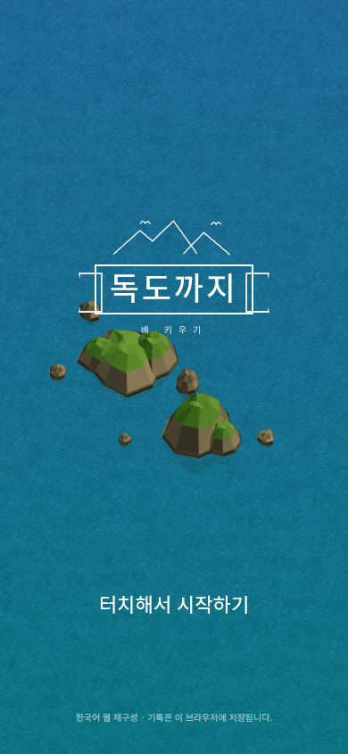
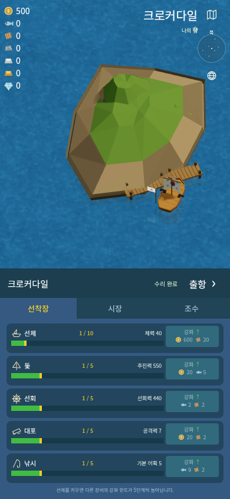
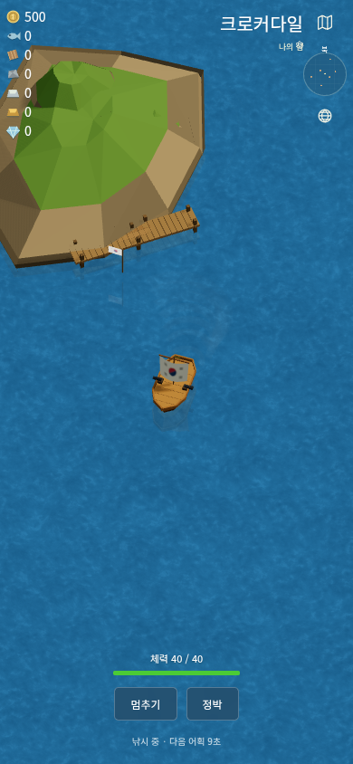

# 스크린샷 비교와 그래픽 수정

2026-10-10, Unity 없는 한국어판의 두 번째 그래픽 작업입니다.

## 관찰에 사용한 화면

- [DOKDO Android 1.4.2 소개와 스크린샷 목록](https://dokdo.en.uptodown.com/android)
- [DOKDO 게임 소개](https://gamewith.jp/gamedb/2433)
- [기존 비공식 브라우저 복원판](https://dokdo.online/Desktop/)의 시작 화면, 조작/전투 안내 화면, 초기 항구 화면을 실제 브라우저로 열어 관찰했습니다. 이 사이트는 이 프로젝트와 별개입니다.

이미지 호스트에서 직접 내려받기를 허용하지 않은 일부 스크린샷은 분석 대상으로 집계하지 않았습니다. 구체적인 형상·색상·배치 비교는 직접 확보한 기존 복원판의 화면을 기준으로 했습니다. 원본 Android 실행 화면과 픽셀 일치 검증을 한 것은 아닙니다.

## 관찰 → 구현

| 구분 | 이전판의 차이 | 수정 내용 |
| --- | --- | --- |
| 바다 | 큰 얼룩과 선명한 고리 무늬 | 여러 크기의 가는 물결을 합성하고, 제목 화면의 위쪽 파랑/아래쪽 청록 농도 차이 추가 |
| 카메라 | 배가 섬 뒤에 보이는 방향 | 선착장 앞에서 바라보는 방향으로 전환; 한국어 항구명은 오른쪽 위로 이동 |
| 지형 | 둥근 받침대에 구형 바위 | 불규칙한 해안선, 삼각형 절벽, 갈색 암반, 초록 능선; 지형별 실루엣 변화 |
| 독도 | 커다란 두 다면체 | 좌우 암봉과 주변 작은 바위 군락, 높이와 능선 차이 |
| 선박 | 하얀 돛과 작은 꼭대기 깃발 | 낮은 갈색 목선, 갑판 이음매와 난간, 돛 전체의 깃발 문양, 단계별 돛대/선체 변화 |
| 항구 | 배 아래까지 이어지는 짧은 판자 | 해안에서 내려오는 통로와 가로로 긴 선착장, 해면 아래 기둥 |
| 수면 | 반사 없음 | 배와 섬의 희미한 수면 반사, 해안가에 움직이는 잔물결 |
| 자원 | 큰 아이콘과 이름 | 왼쪽 위의 작은 아이콘/숫자 세로 배열 |
| 강화 UI | 가로로 나열된 카드 5개 | 남색 바탕의 세로 목록 5개, 성장 막대, 오른쪽 청록색 강화 버튼 |
| 제목 | 큰 문자와 평행선 | 작은 암봉 선화와 리본 테두리, 아래쪽 시작 안내 |

독립 작성한 모델과 셰이더이므로 원본 모델/텍스처를 그대로 복원한 결과는 아닙니다. 카메라와 메뉴는 화면 비율에 맞게 조정하며, 작은 화면에서 원본 UI와 다른 배치가 생길 수 있습니다.

## 현재 화면

